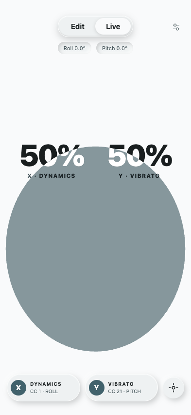

# Glissway 气泡几何修复与验证

交付文件：`ui-preview.html`。可直接以 `file://` 打开，无第三方依赖（同目录加载 glissway-presets.js）。原有 Monet 原生色板接口、传感器、MIDI 映射、Edit/Live 保留。

## 中心残留的原因

旧求解器先把射线半径限制在屏幕边界内，再以二分压力恢复全部可见面积。轮廓无法继续出屏，膨胀便沿剩余方向向中央回填；参考中心本身也被限制在屏幕内。这两项约束共同产生了伪锚定。

## 算法调整

- 将实际 Roll/Pitch 经灵敏度与最大角度限制后，分别映射为连续位移；不读取 MIDI 百分比。每个轴都保留完整行程，组合倾斜时可到达对应角落。
- 先在气泡自身坐标中生成 96 段周期三次 B 样条。二次与三次角向分量共同产生压缩、侧向展开和柔软的不对称形变，轻倾角也有变化。
- 用曲线积分计算完整轮廓面积及真实几何重心，只围绕气泡自身重心做一次面积归一化，然后整体平移。取消射线墙约束、压力二分和可见面积补偿。
- 最大单轴姿态下，完整重心到达屏幕外：水平方向约超出 0.18 倍默认水平半径，垂直方向约超出 0.28 倍默认垂直半径。形变不会把重心拉回中央。
- SVG 使用与屏幕圆角一致的显式裁切；完整轮廓继续出屏，可见面积自然减少。气泡与文字颜色遮罩同步更新。
- 每次输入从当前姿态重新计算全部几何。没有速度、惯性、弹簧、阻尼、帧间插值或时间缓动。位移多项式仅映射当前角度。

## 调试数据

按 D 或从设置进入开发调试。新增屏幕中心覆盖、默认气泡中心覆盖、完整曲线实际重心、可见面积比例、左/右/上/下边缘与圆角接触。Edit 中的几何调试也实时更新，不更改手动 MIDI 值。

点包含检测直接针对最终写入 SVG 的三次曲线做射线求交，再与屏幕裁切区域求交；并非比较参考中心坐标。完整面积与重心使用对三次曲线精确的五点高斯积分。可见面积使用最终曲线与圆角边界的自适应多边形裁切，几何采样容差为 0.02 px。

## 浏览器验收

Chrome 无头模式，393 × 852，默认配置与原始 MIDI 映射。中央矩形检查范围为 x=35%–65%、y=40%–60%，每个姿态取 21 × 21 个点，并使用浏览器原生 `SVGGeometryElement.isPointInFill()` 检测。

| Roll | Pitch | X / Y | 屏幕中心 | 默认气泡中心 | 可见面积比 | 中央矩形覆盖率 |
| ---: | ---: | :---: | :---: | :---: | ---: | ---: |
| 0° | 0° | 50% / 50% | 覆盖 | 覆盖 | 100.00% | 100.00% |
| -15° | 0° | 33% / 50% | 覆盖 | 覆盖 | 91.12% | 98.87% |
| 15° | 0° | 67% / 50% | 覆盖 | 覆盖 | 91.12% | 98.87% |
| -30° | 0° | 17% / 50% | 覆盖 | 覆盖 | 69.25% | 55.78% |
| 30° | 0° | 83% / 50% | 覆盖 | 覆盖 | 69.25% | 55.78% |
| -45° | 0° | 0% / 50% | 露出 | 露出 | 37.77% | 0.00% |
| 45° | 0° | 100% / 50% | 露出 | 露出 | 37.77% | 0.00% |
| 0° | -15° | 50% / 28% | 露出 | 覆盖 | 99.96% | 38.32% |
| 0° | 15° | 50% / 72% | 覆盖 | 覆盖 | 100.00% | 100.00% |
| 0° | -35° | 50% / 0% | 露出 | 露出 | 58.06% | 0.00% |
| 0° | 35° | 50% / 100% | 露出 | 露出 | 80.81% | 0.00% |
| -45° | -35° | 0% / 0% | 露出 | 露出 | 15.54% | 0.00% |
| -45° | 35° | 0% / 100% | 露出 | 露出 | 25.33% | 0.00% |
| 45° | -35° | 100% / 0% | 露出 | 露出 | 15.54% | 0.00% |
| 45° | 35° | 100% / 100% | 露出 | 露出 | 25.33% | 0.00% |

- 774 组尺寸、角度、最大角度、灵敏度和运动反转检查通过；包含 320×568、360×640、393×852、412×915、852×393、768×1024。完整面积最大误差 0.0000785%，重心与预定位移中心最大偏差 0.0000782 px。
- 24 条从水平到单轴/组合极端姿态的路径，共 4320 个连续采样通过。每条路径中心覆盖只翻转一次；可见面积持续减少，无跳变或消失。
- 15 个重点姿态的可见面积另外用 4 倍分辨率 Canvas 屏幕裁切、逐像素 alpha 积分核对，与求解器最大差异 0.0191%。
- 原生姿态接口、方向传感器数据入口、归零、MIDI 输出反转与角度范围、Edit 手动 MIDI、Live 切换、Monet 原生颜色覆盖、文件直接打开均通过浏览器检查；浏览器未出现 JavaScript 错误。
- 已检查水平、Roll 30°、Roll 45°、Pitch 35°、组合极端姿态及横屏/小屏截图。极端轮廓向边缘/角落聚集，中央背景明显露出。

## 可重复运行的回归测试

仅需 Node.js，无 npm 依赖：

```sh
node --test design/tests/bubble-geometry.test.mjs
```

覆盖最终序列化轮廓的独立点包含检测、极端中央区域露出、完整面积、连续裁切、配置与方向反转、轻倾形变、历史无关性，以及极端轮廓无自交。


